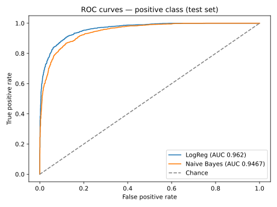
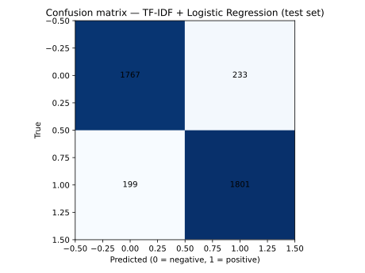

# Sentiment Analysis & Simple RAG Q&A — IMDB Movie Reviews

🚀 **Live demo:** [Try the app](https://gkha5ybqsvsmnyagzjeakj.streamlit.app/)

Two things in one repo, both built on the same data:

- **Part A — Sentiment analysis:** is a movie review positive or negative?
  TF-IDF + Logistic Regression, compared with Naive Bayes and a
  majority-class baseline.
- **Part B — Simple RAG Q&A:** ask a question about the reviews and get
  the most relevant passages back, with scores and source ids.

## Results — Part A (test set, n = 4,000)

Stratified 80/20 train/test split (`random_state=42`) on a stratified
20,000-review subsample of the full 50,000-review dataset
(10,000 positive / 10,000 negative). Metrics are for the **positive** class.

| Model | Accuracy | Precision | Recall | F1 | ROC-AUC |
|---|---|---|---|---|---|
| Majority class baseline | 0.500 | 0.000 | 0.000 | 0.000 | — |
| TF-IDF + MultinomialNB | 0.866 | 0.856 | 0.880 | 0.868 | 0.947 |
| **TF-IDF + Logistic Regression** | **0.892** | **0.885** | **0.901** | **0.893** | **0.962** |

Reproduce: `python src/train.py` — it prints these numbers and writes
`metrics.json` plus the plots in `plots/`.

Most informative words (Logistic Regression weights):

- **Positive:** great, excellent, wonderful, best, amazing, perfect,
  love, loved, fun, the best
- **Negative:** bad, worst, awful, the worst, boring, waste, poor,
  terrible, nothing, stupid




## Worked example — Part B (RAG)

Question: **"Was the plot boring or exciting?"**

TF-IDF cosine retrieval over 50 review passages
(`data/rag_corpus.jsonl`), top-3:

| Rank | Doc | Score | Sentiment | Passage (truncated) |
|---|---|---|---|---|
| 1 | `rag_031` | 0.1303 | negative | "…The acting was non-existent, the plot was somewhere other than on this film…" |
| 2 | `rag_038` | 0.0918 | negative | "The plot is pathetic, the acting awful, and the dialogue is even more predictable than the ending." |
| 3 | `rag_028` | 0.0845 | negative | "The plot is that Asmodeus … has a plot to become human… The plot isn't clear on this…" |

Run it yourself: `python src/rag.py "Was the plot boring or exciting?"`

> **Honest note — what this RAG is and is not.** This is **retrieval +
> extractive passage display, not a generative LLM**: a question is
> matched against the 50 passages with TF-IDF cosine similarity, and the
> top-3 passages are shown as-is. No answer is written by a model, no
> large transformer is downloaded, and nothing is generated from a
> model's own knowledge. The scores are also low in absolute terms
> (a short question against long passages), and ranking is purely
> keyword-based — so an off-topic passage can occasionally top the list
> for a generic question (e.g. for "What do reviewers say about the
> acting?", the top hit shares only generic words with the question,
> while the genuinely on-topic passage ranks second). That is a real
> limitation of keyword retrieval on a 50-document corpus, and the
> honest fix would be a larger corpus and/or semantic embeddings.

## Method

### Part A — Sentiment
1. **Data** — Large Movie Review Dataset (Maas et al., 2011): 50,000
   reviews, 25,000 positive / 25,000 negative. See "Dataset" below.
2. **Cleaning** — HTML `<br />` tags stripped; TF-IDF lowercases and
   tokenises the rest. No stopword removal beyond TF-IDF defaults.
3. **Features** — TF-IDF, word uni- + bi-grams, `max_features=20,000`,
   `sublinear_tf=True`, `min_df=2`.
4. **Models** — Logistic Regression (`C=1.0`, `max_iter=1000`) vs
   MultinomialNB (`alpha=0.1`) vs majority-class baseline, all on the
   same TF-IDF features and the same test split.

### Part B — RAG
1. **Corpus** — 50 passages (25 positive / 25 negative), each the first
   ~700 characters of a real review from the 20,000-review sample,
   stored in `data/rag_corpus.jsonl` with a document id and the source
   review's index in the full file.
2. **Retrieval** — TF-IDF (`max_features=5,000`, uni- + bi-grams) over
   the passages; a question is ranked by cosine similarity, top-3 shown
   with score, sentiment and source id (`src/rag.py`).

## Dataset

Large Movie Review Dataset (IMDB, Maas et al., 2011) — 50,000 reviews,
25,000 positive / 25,000 negative.
Source: http://ai.stanford.edu/~amaas/data/sentiment/

The full CSV (~66 MB) is **not bundled in this repo** — it is too large
for a clean snapshot and is downloaded once by `src/train.py` from a
public mirror (primary: `rasbt/pattern_classification` on GitHub;
fallback: `Ankit152/IMDB-sentiment-analysis`) into `data/imdb_full.csv`
(gitignored). A stratified 2,000-review sample *is* bundled in
`data/imdb_sample.csv`, so the Streamlit demo works offline; if the
download ever fails, `src/train.py` falls back to that sample and says so.

## Demo

```bash
pip install -r requirements.txt
streamlit run app.py
```

Two tabs: **Sentiment** (type a review, get a prediction + probability)
and **Ask a question** (RAG retrieval over the 50 passages). The demo
trains its small sentiment model in memory from the bundled 2,000-review
sample; the full 20,000-review model and its metrics are in `src/train.py`
/ `metrics.json`.

## Project structure

```
├── app.py                  # Streamlit demo (Sentiment + RAG tabs)
├── data/
│   ├── imdb_sample.csv     # bundled stratified 2,000-review sample
│   └── rag_corpus.jsonl    # 50 passages for RAG (with source ids)
├── metrics.json            # measured test-set results (from src/train.py)
├── plots/
│   ├── roc_curves.svg
│   └── confusion_matrix.svg
├── requirements.txt
└── src/
    ├── train.py            # sentiment training + evaluation
    └── rag.py              # TF-IDF retrieval over the 50 passages
```

## Limitations

- Single dataset, single split — accuracy would need cross-validation
  before any production claim; IMDB reviews are also a narrow domain
  (movie language does not transfer to, say, product or finance text).
- The 20,000-review subsample is a compute choice, not a data limit;
  the full 50,000 would likely add a point or two.
- The RAG corpus is only 50 passages and retrieval is keyword-based:
  it cannot understand synonyms ("dull" vs "boring") or answer
  questions whose words do not appear in any passage. No generative
  model is used, by design — see the honest note above.
- Review texts are raw user writing: some passages contain strong
  language. They are quoted as they appear in the dataset.
